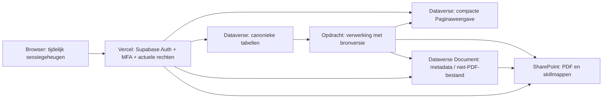

> **Actualisatie 12 november 2026:** voor de Shows-module is
> [shows-schema.md](shows-schema.md) het concrete actuele aanmaakcontract.
> Het nieuwere gebruikersbesluit vervangt alle PDF-naar-SharePoint-passages in
> dit oudere ontwerp: PDF’s worden opgeslagen in **Dataverse File**;
> SharePoint/ESMOJO Bibliotheek is uitsluitend voor ChatGPT-uitwisseling.
> De bestaande onderzoekstabel met volledige Markdown blijft behouden.

# Architectuur en snelle interactie

Status: ontwerp, geen wijziging van de huidige website. Bestaande validators,
risicoberekeningen, bronregels, afrondcriteria en modulegrenzen blijven leidend.

## Gegevensroute

Dataverse wordt de primaire opslag voor actieve én historische applicatiegegevens;
SharePoint bewaart centraal de PDF’s en de vier aangewezen skillmappen.
Geen normale pagina-aanvraag met Drive-bridge, archiveringshandoff of CSV-parse.
Supabase Auth blijft dezelfde user-ID/sessie/MFA leveren. Profiel en modules gaan
naar Dataverse; geen rol uit onbevestigde gebruikersmetadata vertrouwen.
De Microsoft-app krijgt een beperkte productie-rol. Autorisatie van medewerkers
blijft ESMOJO-verantwoordelijkheid: de S2S-appidentiteit is geen eindgebruikersrecht.

## Eén pagina-antwoord, geen alles-in-één bronrecord

`Paginaweergave` heeft een versiecontract en een expliciete soort/rechtenscope.
Een aanvraag ontvangt uitsluitend de toegestane velden, niet een universele dump.
Voorgestelde contractnamen zijn ontwerpen, geen nieuwe geïmplementeerde routes.

| Contract | Eerste antwoord | Niet inbegrepen |
|---|---|---|
| show-workspace | Header, reeksdatums, projectteam, planning, Showprofiel-vragen/samenvattingen/afrondbasis, actuele productiekeuzes, barrier-/floorbasis, ticketreferenties, operationele risico’s/beoordelingen, maatregeltekst/status/briefing, documentmetadata | Oude revisies, binaire bijlagen, PDF-bytes, volledige onderzoekbijlagen, incidenten |
| artist-landing | Naam/tekst/fotoreferentie, vier bezoekerskaarten met vastlegging, ruwe/display-score en volledigheids-/actualiteitsstatus, historie, compacte historische showoverzichten | Volledige incidentlijsten en PDF’s |
| report-ready | Geselecteerde uitvoering/datum, bron/datasetversie, tijdschema, alle totalen/filters/grafieken, beschikbare datums; bij klein/normaal alle incidentregels | PDF/fotobytes, bronnen van andere shows, oudere bestandversies |
| report-large | Dezelfde volledige aggregaten plus eerste incidentregels en versiegebonden paginacursor | Alleen toegestaan na bewijs volgens meetplan; nooit gedeeltelijke totalen |
| menus/home | Kleine expliciete metadata-/statusprojectie; top-5 gekoppeld aan vaste Nederlandse dag | Privéteksten, incidentinhoud, ongeautoriseerde persoonlijke koppelingen |

De 36 tabellen zijn voor betrouwbaar beheer. Een scherm vraagt niet alle tabellen
apart op. Eén browseraanvraag kan nog een noodzakelijke rechtenread en gerichte
Dataverse-read vereisen. `$batch` is geen gratis snelheidsoplossing: interne
operaties blijven meetellen en moeten afzonderlijk begrensd/gemeten worden.

Showworkspace-voorstel: wirebudget aanvankelijk 200 KiB gecomprimeerd. Artiest
100 KiB; normale rapportage 250 KiB. Dit zijn te toetsen budgetten, geen bewezen
bestandsgroottes of harde reden om normale rapportages op te delen. Als het niet
past: onnodige velden/duplicaten verwijderen en query/UI verbeteren vóór extra IO.

## Showtabbladen zonder wachtronde

- Bij het gereedmelden zijn data én interfacecode voor Showprofiel, Risicoanalyse
  en Maatregelen beschikbaar. Geen import()/API-call pas bij de eerste tabklik.
- Directe `?tab=maatregelen`, Showprofiel- en risicodeeplinks gebruiken dezelfde
  bundel en openen direct de juiste toestand. Geen verplichte tussenlanding.
- Reeds geladen editors gebruiken gedeelde show-sessiestaat; dezelfde concepten
  en wachtrijen blijven bij heen/terug behouden.
- Verouderde broninformatie wordt als zodanig herkend; afronding vereist actuele
  bronversies. 'Alles snel zichtbaar' is geen toestemming om oude revisies op te slaan.
- Een nog niet gegenereerde AI-risicobron blijft de bestaande zakelijke status;
  de pagina wacht niet synchroon op AI/PDF-generatie.
- Aanvullende bijlagen, oude historie en downloads blijven expliciete aparte acties.

Dit verfijnt het eerdere idee van volledig lazy tabdata: deze drie tabbladen
moeten juist voorbereid zijn. Andere zware routes kunnen code-splitting gebruiken.
Server-PDF/AI-code en fontassets hoeven niet bij een gewone pagina-read op te starten.

## Barrieropstelling → vloerdruk: concrete ingreep

### Huidige keten, vastgesteld in code

1. `src/barrier-layout-page.js` zet draft/upload/complete waar nodig achter elkaar
   en navigeert direct terug; deze keten is voor hetzelfde item terecht geordend.
2. `src/risk-analysis.js:backFromAssessment` vernieuwt het overzicht na afhandeling,
   alleen wanneer het overzicht dan nog actief is. Een snelle volgende klik kan
   daardoor een venster met nog niet vernieuwde basis tegenkomen.
3. `src/lib/show-data.js` serialiseert writes via één showbrede writeTail en
   invalideert floorgegevens wanneer de bevestigde barriersignatuur verandert.
4. De floor-editor doet een read en blokkeert bewerken tijdens die fase. Hij
   gebruikt de opgeslagen barrierbasis en ticketreferentie.
5. `server/active-show-store.js` kan voor floor/ticketgegevens nog een signed
   Drive-bridge gebruiken. De huidige opslaggrens veroorzaakt extra rondes.

Dit zijn mogelijke wacht-/verouderingspaden; hun duur is nog niet gemeten.
De lokale formule zelf (`shared/floor-pressure.js`) is al synchroon. Die hoeft
niet 'sneller naar een server'; de beschikbaarheid van de juiste invoer moet beter.

### Doelgedrag

- Relevante ticketgegevens, vakdefinities, laatste barrier- en floorbasis zitten
  al in de showbundel. Beschermde schema-afbeeldingen mogen de berekening niet blokkeren.
- Expliciet kiezen van een barrier zet een sessiegeneratie en lokale gewenste
  configuratie. Vloerdrukvelden en de voorlopige bezoekers/m²-berekening kunnen
  direct op die bekende invoer reageren, zonder een floor-read af te wachten.
- Dit voorlopige concept wordt niet als afgerond of opgeslagen weergegeven.
  De keuze om met nog niet bevestigde barrierinvoer te rekenen is een expliciete
  ontwerpverfijning tegenover de huidige stored-only floor-read; bewijzen in de proef.
- Handmatig Opslaan/afronden bij barrier en vloer blijft behouden. Geen nieuwe autosave.
- Kleine, onafhankelijke resources hebben eigen wachtrijen. Een maatregeltekst,
  PDF-job of foto-upload houdt een onafhankelijke berekening niet tegen.
- Een vloerafronding wacht uitsluitend op haar eigen barrier-/ticketbasis, niet
  op alle showwrites. Een custom-barrierbijlage moet wel geverifieerd zijn vóór
  de afhankelijke definitieve afronding als de bron daarvan afhangt.
- Upload buiten een langdurige showlock; gekoppeld resultaat pas beschikbaar
  verklaren na integriteitscontrole. Technisch onzekere opslag blijft onbevestigd.
- De server bevestigt expliciet de opgeslagen barrierrevisie/signatuur en ticket-
  versievector. Die worden direct in de gedeelde sessiestaat verwerkt; een oude
  reactie mag een nieuwere lokale keuze niet terugzetten.
- Onzekere of gewijzigde bron: concept bewaren, gerichte teruglees-/conflictafhandeling,
  geen volledige herbouw van alle tabbladen. Afsluitwaarschuwing blijft nodig voor
  nog niet verstuurde of onbevestigde invoer; geen privé-offlineopslag toevoegen.

Definitieve basis: barrier-domeinrevisie + type/afbeeldingshash + relevante
bezoekersveldversies + dagwaarden + eigen floorrevisie. Maximum over reeksdagen,
geen som; vaste/afwijkende vakregels, Seated en invalidatie blijven hetzelfde.
Een wijziging A→B→A mag een oude afrondactie niet alsnog geldig maken.

**Technische raceproef verplicht:** een read en daarna een losse floor-PATCH zijn
geen atomaire broncontrole. Bewijs een korte platformtransactie/Custom API met
vergelijking en gecoördineerde bron-guard (Technische status), waarin alle relevante
writers deelnemen. Dataverse ETags beschermen de eigen rij, niet automatisch de
barrier- en ticketrijen samen. Geen implementatiekeuze als bewezen presenteren vóór
succes onder gelijktijdige bronwijzigingen. Dat geldt ook voor handmatige beheermutaties.

## Artiest: meteen compleet, daarna stille rapporten

Eerste weergave omvat alle vier bezoekerskaarten en beschikbare score. Score bevat
ruwe onderdelen, zichtbare hele punten, volledig/onvolledig/onbeschikbaar, model-
en referentiedag, bronfingerprint en actualiteit. Volledig/onvolledig is een andere
as dan actueel/bijwerken. Geen oude score ongemerkt als nieuw berekend presenteren.

Compacte historische showoverzichten (de zes kaarten) worden vooraf opgebouwd.
Daarvoor wordt geen volledige CSV/incidentlijst opgehaald. Ze reizen waar passend
met de landing mee; bij grote historie eventueel een begrensde compacte bundel,
waarvan de beperking eerst op echte omvang moet worden getoetst.

Volledige rapporten: pas na zichtbare, interactieve landing; nieuwste concert
naar oudste; één gecontroleerde zware aanvraag tegelijk. Eén pending aanvraag
per rapport; aangeklikt rapport vooraan in de nog niet gestarte wachtrij. Niet
beweren dat een bestaande netwerkcall altijd direct onderbroken kan worden.
Klikresponsiviteit ook bij een lopende zware oudere aanvraag meten; zo nodig
veilig afbreken/herplannen of streng begrensde voorgrondcapaciteit testen.

- Achtergrondwerk toont geen spinner bij datums of in de pagina.
- Alleen expliciet wachten op de geselecteerde rapportage toont het bestaande
  submenu-rondje naast de actieve artiest.
- Afzonderlijke gereedmeldingen, foutisolatie en bewuste retry blijven bestaan.
- Navigatie stopt overbodig achtergrondwerk; oude artiestresultaten niet tonen.
- Hele historische reeksen onbeperkt als grote payloads voorladen is geen eis:
  compacte showkaarten kunnen al direct werken. Prefetchbudget beschermt Dataverse
  tegen veel gelijktijdige gebruikers met lange histories.

## Rapport: verwerking vóór het openen

CSV-import → originele bytes opslaan → bestaande parser/validatie → genormaliseerde
incidenten en broncounts → aggregaten/filters/tijdlijn → klaarstaande rapportweergave.
Een gewijzigde bron maakt een nieuwe bronversie. Een download blijft apart.

Behoud de bestaande parser en gedeelde score-/filterlogica. OnTrack automatisch,
OnTrack historisch en TSC historisch zijn verschillende broncontracten. TSC-
uitzettingen/aanhoudingen komen uit de eerste rij; null is niet nul. Afzonderlijke
bronrapporten/uitvoeringen niet samenvoegen op alleen datum/zaal. Eén bezoekersbasis
per echte uitvoering; niet verdubbelen vanwege meerdere bronrapporten.

Aggregaten tellen de volledige gekozen dataset, ook als incidentregels gepagineerd
zijn. Paging/filtercursor bindt aan concert, bronversie, filter en sorteervolgorde.
Geen nieuwe incidentregels combineren met oude totalen; geen versies mengen tussen
pagina 1 en pagina 2. Bij bronwisseling coherent vernieuwen of oude expliciete
snapshot afmaken. Alle filteropties behouden hun bestaande definities.

Kleine/normale rapportages blijven volledig. Virtuele rendering van een lang
DOM en verwijderen van onnodige velden eerst meten. Opdelen van incidenttransport
alleen voor grote rapportages, na het A/B-bewijs in meetplan.md.

## Opslaan, publicatie en integriteit

- Canonieke mutatie, command-ID/ontvangstbewijs en noodzakelijke invalidering/
  lichte statusprojectie in een getoetste platformtransactie. Bij onzekere respons
  hetzelfde commando terugzoeken; geen dubbele mail, import of afronding.
- Rij-ETag, domeinrevisie en bronbasis hebben elk een eigen doel. Historie bevat
  de echte medewerker en oorspronkelijk tijdstip; niet de technische app als auteur.
- Zware opdrachten krijgen versie-/scopegebonden idempotentiesleutels en leases.
  De beperkte hoeveelheid echte verwerking hoort in de worker, niet bij pagina-open.
- Paginaweergave bewaart gepubliceerde bronversie en gewenste generatie. Een worker
  mag alleen bij passende generatie publiceren (CAS); een oud resultaat kan geen
  nieuwere stand terugdraaien. Stabiele gegevens uit bronversies, geen willekeurige
  mix van opeenvolgende GET's tijdens gelijktijdige wijzigingen.
- Kleine showstatus-/tekstwijzigingen zo mogelijk direct in dezelfde commit
  projecteren. Een achtergrondworker mag geen nieuwe wachtronde voor gewone tabkliks
  veroorzaken. Zware scores/rapporten hebben expliciete verwerkings-/actualiteitsstatus.
- Laatste goede afgeleide inhoud niet wissen bij fouten, maar niet ongemerkt als
  actueel/definitief presenteren. Ongeldige afrondingen blijven ongeldig.
- Dagreferenties en dagranking rond 00:00 Europe/Amsterdam voorbereiden/publiceren;
  geen gedeeltelijke dagstand. Vorige complete stand bij fout behouden. GitHub-cron
  biedt geen harde exact-op-middernachtgarantie: scheduler/publicatielag meten en
  zo nodig een expliciet geschikte scheduler kiezen vóór de claim 'precies 00:00'.

## Caches, requests en code

- Eerst compacte Dataverse-reads, tijdelijke browser-/servergeheugencache en
  verzoekcoalescing; geen nieuwe gedeelde cache van vertrouwelijke inhoud.
- In-memory cache strikt per actor/rechtenscope/versie; bij afmelden/rechtenwissel
  wissen. Geen profiel, rapport, top-5 of token in localStorage/IndexedDB/serviceworker.
  De eerder toegestane openbare menumetadata blijft een beperkte uitzondering.
- Iedere aanvraag behoudt geldige sessie, MFA en actuele rol/modulecontrole.
  Niet zomaar getUser verwijderen of gebruikersrechten langdurig cachen voor snelheid.
- Test en productie krijgen afzonderlijke configuratie/omgevingcontrole en
  cachesleutels. De huidige TEST-variabelen of op US-host begrensde proefroute
  niet stil ombouwen tot algemene productieprovider.
- Microsoft-app-token tijdelijk server-side hergebruiken met afloopmarge en
  singleflight vernieuwing; geen token in responses/logs/inhoudscaches. De proef
  vraagt nu bewust iedere keer een nieuw token; dat is geen productie-laadstrategie.
- Alleen benodigde `$select`-velden en geïndexeerde lookups/alternatieve sleutels.
  Dataverse zoekt geen complete tekst-JSON uit om alle concerten te vinden.
- OData-nextLink blijft onder de vaste gecontroleerde omgeving; geen vrije proxy.
  Begrensde concurrency; Retry-After respecteren. Geen onzichtbare retry-storm.
- Dataverse-regio en Vercel-verwerkingsregio afstemmen. De huidige US-devomgeving
  is geen bewijs voor EU-productielatency. Vercel-coldstart en grote serverimports meten.
- Hero/afbeeldingen reserveren vaste ruimte en krijgen geschikte resolutie.
  Een foto-opvraag naar MOJO hoort niet synchroon bij iedere rapportread.
